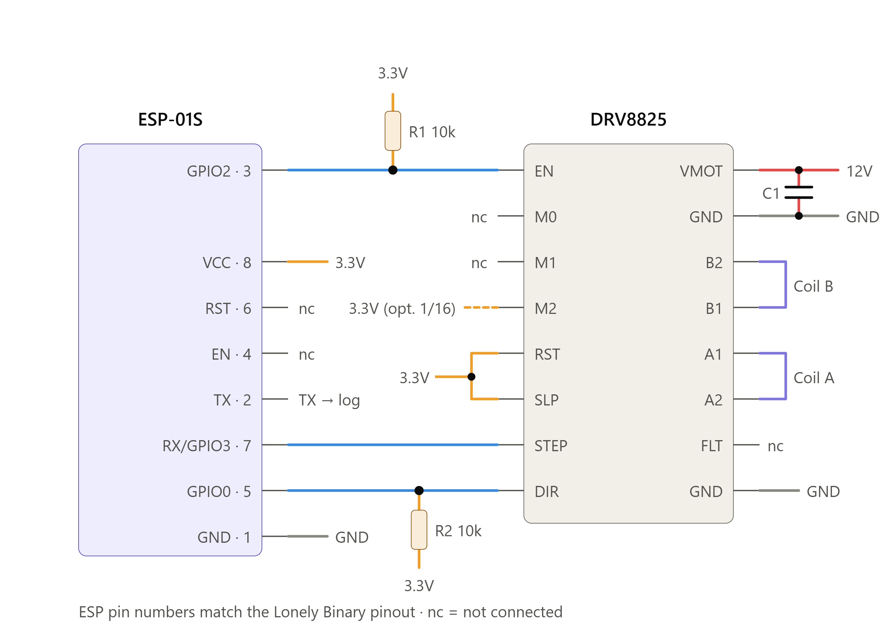
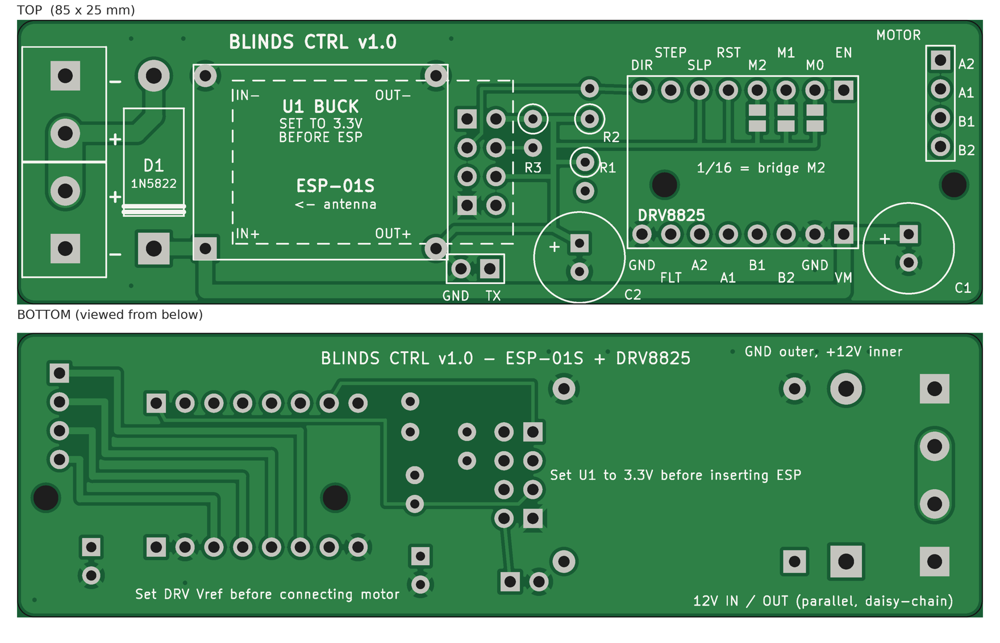
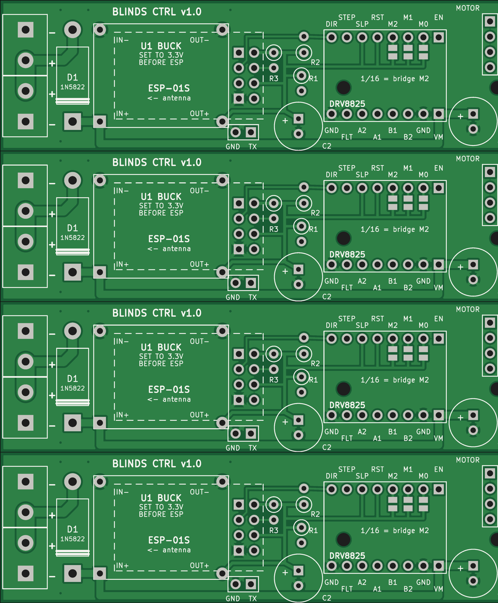

# IOT Blinds with PlatformIO

Motorized window blinds controller: ESP8266 + DRV8825 stepper driver + 28BYJ-48 style stepper, driven over MQTT. Each controller runs from a shared 12V line.

Fork of https://github.com/thehookup/Motorized_MQTT_Blinds

## Hardware

There are two hardware variants. The firmware picks the right pin map at compile time.

| Variant | Board | EN (sleep) | DIR | STEP | Build flag |
|---|---|---|---|---|---|
| PCB v1.0 (current) | ESP-01S | GPIO2 | GPIO0 | GPIO3 (RX) | none |
| Hand-wired (old) | D1 mini / NodeMCU | D5 (GPIO14) | D6 (GPIO12) | D7 (GPIO13) | `-DOLD_HW` |

On the PCB, STEP uses the RX pin, so serial is TX-only (log output at 115200).

### Wiring diagram

ESP-01S to DRV8825 wiring used by the PCB:



- R1 pulls EN up, so the driver stays off while the ESP boots.
- R2 pulls DIR/GPIO0 up, so the ESP boots from flash, not into flash mode.
- DRV8825 RST and SLP are tied to 3.3V.
- Bridge M2 to 3.3V only if you want 1/16 microstepping.

Wiring for the old hand-wired boards (NodeMCU / D1 mini, from the original project): [Schematic.jpg](Schematic.jpg)

### PCB design

BLINDS CTRL v1.0 is a 2-layer, 85 x 25 mm board. It carries an MP1584EN buck module, an ESP-01S and a DRV8825 carrier, all in sockets. The two 12V screw terminals are wired in parallel, so you can daisy-chain power from one controller to the next.



Files in [pcb/](pcb/):

| File | What it is |
|---|---|
| [blinds_panel_4x.kicad_pcb](pcb/blinds_panel_4x.kicad_pcb) | KiCad 7 layout: 4 boards on one 85 x 100 mm panel |
| [blinds_panel_4x_gerbers.zip](pcb/blinds_panel_4x_gerbers.zip) | Gerbers + drill files, ready to upload to JLCPCB |
| [blinds_ctrl_BOM.csv](pcb/blinds_ctrl_BOM.csv) | Bill of materials |
| [blinds_ctrl_preview.png](pcb/blinds_ctrl_preview.png) | Single board render, top and bottom |
| [blinds_panel_4x_preview.png](pcb/blinds_panel_4x_preview.png) | Panel render |
| [esp01s_to_drv8825_wiring.png](pcb/esp01s_to_drv8825_wiring.png) | Wiring diagram |

### Bill of materials

Per board:

| Ref | Qty | Part | Notes |
|---|---|---|---|
| J1 J2 | 2 | Screw terminal 2-pin 5.08 mm (KF301-2P / DG301) | 12V in + 12V out; wired in parallel for daisy-chaining. GND outer pin / +12V inner pin |
| D1 | 1 | 1N5822 Schottky 3A 40V (DO-201AD) | Reverse-polarity protection for this board only; the chain bus bypasses it. Bridge with wire to omit |
| U1 | 1 | MP1584EN buck module 22x17 mm | Set to 3.3V BEFORE fitting the ESP. Solder with header-pin legs; pads on 20.32 x 15.24 mm |
| U2 | 1 | 2x4 female header 2.54 mm + ESP-01S | ESP overhangs the buck; antenna toward the terminals |
| U3 | 1 | 2x 1x8 female header 2.54 mm + DRV8825 carrier | EN/VMOT end toward the motor connector; match the pin labels on the silkscreen |
| R1 R2 R3 | 3 | 10k 1/4W resistor (stand-up mount) | R1 EN pull-up; R2 DIR/GPIO0 pull-up; R3 ESP RST pull-up |
| C1 | 1 | 100uF 25V electrolytic (6.3 or 8 mm dia; 2.5 mm pitch) | On VMOT. Do not use a 16V part here |
| C2 | 1 | 220uF 16V electrolytic (max 8 mm dia; 2.5 mm pitch) | On 3.3V near the ESP |
| J3 | 1 | 1x4 male header 2.54 mm (or JST-XH 4-pin) | Motor: A2 A1 B1 B2 (coil A = pins 1-2; coil B = pins 3-4) |
| J5 | 1 | 1x2 male header 2.54 mm (optional) | Serial log: TX + GND at 115200 |
| JP1 JP2 JP3 | 0 | Solder jumpers (M0 M1 M2 to 3.3V) | Under the driver; bridge M2 only for 1/16 microstepping |
| H1 H2 | 2 | M2 screws | H1 sits under the driver: screw it down before plugging in the DRV8825 |

Plus a 28BYJ-48 stepper (or similar) and a 12V supply.

### Assembly order

1. Solder the resistors, D1, the capacitors, the terminals and the headers.
2. Solder U1 (buck module). Power the board with 12V and turn the buck trimmer until the output reads **3.3V**. Do this before you plug in the ESP-01S: the buck often ships set higher, and that kills the ESP.
3. Screw down H1, then plug in the DRV8825. Set its current limit (Vref) **before** you connect the motor.
4. Plug in the ESP-01S (flash it first, see below), then connect the motor.

## Ordering PCBs from JLCPCB

The [gerbers zip](pcb/blinds_panel_4x_gerbers.zip) is already a panel: 4 boards (85 x 25 mm each) stacked into one 85 x 100 mm panel. They are separated by V-cut lines, which are drawn on the outline layer and labeled `V-CUT`.



To order:

1. Go to https://jlcpcb.com and click **Order now** / **Add gerber file**.
2. Upload `pcb/blinds_panel_4x_gerbers.zip` as-is. Don't unzip it. JLCPCB should detect 2 layers and 85 x 100 mm.
3. Set these options:
   - **Base material:** FR-4
   - **Layers:** 2
   - **Dimensions:** 85 x 100 mm (auto-detected)
   - **Different design:** 1. The panel repeats one design, so it is not 4 different designs.
   - **Delivery format:** **Panel by Customer**. This tells JLCPCB the file is already a panel and not to add its own panelization.
   - **Panel format:** 1 column x 4 rows
   - **Edge rails:** No
   - **PCB thickness:** 1.6 mm
   - Everything else (color, surface finish HASL, 1 oz copper) can stay at the defaults.
4. **PCB Qty** counts panels, not boards. The minimum of 5 panels gives you 20 boards.
5. Optional: "Remove Order Number" (small fee), if you don't want JLCPCB's order number printed on the board.
6. Add to cart and check out. When the boards arrive, snap them apart along the V-cuts.

JLCPCB changes its order form now and then, so option names may differ slightly. Don't pick "Panel by JLCPCB" or "Single PCB": either one makes JLCPCB treat the panel as a single 85 x 100 mm board.

## Firmware

### Configuration

WiFi and MQTT credentials go in `platformio.secret.ini` (not committed):

```ini
[secret]
build_flags =
  '-DWIFI_SSID="..."'
  '-DWIFI_PASS="..."'
  '-DMQTT_HOST="192.168.x.x"'
  '-DMQTT_PORT=1883'
  '-DMQTT_USER="..."'
  '-DMQTT_PASS="..."'
```

Each controller has its own environment in [platformio.ini](platformio.ini). The environment sets `MQTT_CLIENT` (the device name) and the OTA IP. Add `-DREVERSE` if a window turns the wrong way. Add `-DOLD_HW` and `extends = esp_old` for the D1 mini boards.

`MQTT_CLIENT` must be unique per device. Two devices with the same name keep knocking each other off the broker, and both reconnect over and over. The name is also used as the DHCP hostname and the mDNS/OTA name.

### Build and deploy

```
pio run -e OTA4                 # build
pio run -e OTA4 -t upload       # upload over WiFi (OTA)
pio run -e COM -t upload        # first flash over serial
pio test -e native              # unit tests for BlindsController
```

### MQTT

| Topic | Direction | Payload |
|---|---|---|
| `<name>/cmd` | to device | `OPEN`, `CLOSE`, `CLOSE50`, `CLOSE110`, `-CLOSE`, `TOGGLE` |
| `<name>/checkIn` | from device | `connected` on connect, `OK` + IP every 60 s, and the command it just ran |
| `ip` | from device | `<name>:<ip>` |

Debug logs are on telnet port 23 (`monitor_port` in each environment). A minimal web page is on port 80.
